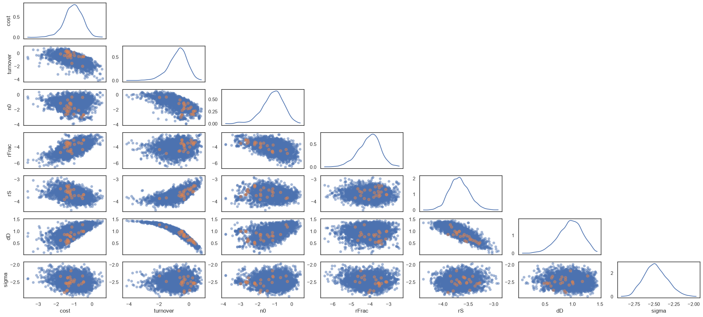

### 

## DATA:

Zhang: Patients were monitored 4-6 weeks. Pt on abiraterone until PSA \< 50% of t1, and then holiday until til PSA returned ≥100% of t1. Either surgical or chemical to maintain castration levels of testosterone. Were taken of trial for radio graphic progression or ECOG deterioration while on treatment [@zhang2022].

### Assumptions in earlier work

Many parameters were fixed.

That noise would be Gaussian when the data is normalized.

```{r}
t <- seq(1, 100, with 0.1)

sigma = 1

rnorm(t, sigma)
```

### Model fitting implementation

The ODE models two populations of cancer cells: treatment-sensitive cells (S) and treatment-resistant cells (R). The model has been used to study how scheduling treatment breaks could delay the emergence of resistance in prostate cancer.

$$
\frac{dS}{dt} = r_SS\cdot(1-\frac{S+R}{K}) \cdot (1-d_D D) - dS \\\frac{dR}{dt} = r_RR\cdot(1-\frac{S+R}{K}) - dR
$$

where $r_S, r_R$ are proliferation rates, $d$ is the cell death rate, $K$ is the carrying capacity, fixed to 1, $D$ is the amount of drug applied, and $d_D$ is the drug-induced cell death rate. We assume that the normalized value of the biomarker prostate-specific antigen, $NormPSA_t = \frac{PSA_t}{PSA_0$, is normally distributed around the cell density $\frac{N_t}{N_0}$ where $N_t=S_t+R_t$:

$$
NormPSA_t\sim Normal(\frac{N_t}{N_0}, \sigma) 
$$

Progression is typically defined as the total cell population exceeding 1.2 times its initial size, that is, when $S+R > 1.2(S_0+R_0)$. However, the ODE can settle into a steady state where the tumor is fully resistant but the total cell population is less than 1.2 times its initial size. We find that we only observe progression under continuous treatment when

$$
1.2N_0< K(1 - \frac{dD}{r_R})
$$

#### ODE is solved Treatment segments

ODE implementation and data wrangling The Lotka-Volterra model is fitted as ODE where the ODE is solved in treatment segments. This means that a starting cell population is inferred and the ODE uses this to solve the cell population up to and including the day when the treatment changes. This is the used as the starting point for the next ODE segment that is solved until up to and including when the treatment switches back. The data at times contains observations where the treatment is switched despite some of the rows on which a switch in treatment is reported don't contain PSA measurements. This is different to biomarker paper that drops all NON psa observations. Per Stan user guide.

### Dividing by first PSA measurement

Since the model doesn't inform how much PSA is produced by a certain number of cells, the model can only estimate how the relative distance from carrying capacity by observing growth rates. To remove the scale how much PSA to how tumor from the system, we divide by the first measurement. N0, sets the level but should always more or less equal the first obs.

### Using pathfinder for init

Using pathfinder inits was to avoid situations where one chain would fit much slower than the rest.'

### How to truncate a prior in stan

### Hierarchical models

Hierarchical models estimate both at individual level parameters and population effects at the same time. Effectively it is learning the prior over individual estimates. This has regularizing effect, depsite multilevel models. While common in sicence, the assumption that more parameters always increase flexibility thus breaks when it comes to hierarchical models. This is due to shrinkage,indiviudal level estimates are pulled towards the mean depending on how uncertain the inidividual estimate is and the estimated variance between individuals. Single level models either maximally "underfit or overfit". This requires to specify the hierarchical structure as assumptions. Benefits of partial pooling or hieratchical modelling increases when individual level data is information-sparse given the desired inference.

This seems like obvious improvement in patient level fits, it not obvious where parameter estimates should correlate.

### posterior geometry 

Posterior geometry is problematic even problematic synthetic data even with tight priors. Turnover and dD form a banana making step sizing difficult since optimal step-sizing in one direction is sub optimal in opposite direction. With standard step size adaptation on synthetic data NUTS HMC divergences frequently.



Lowering adaptation of the step sizes reduces the amount of divergences, but it comes at the cost of sampling speed and potentially increasing the auto-correlation in drawn samples leading to even further need of more iterations to reach same resolution of the posterior as with more aggressive step sizing.

The problem is that the posterior geometry is degenerate. Banana shapes show that the posterior density or realized likelihood is not uniformly spread around a single point. The more degenerate the geometry, the less accurate frequentist procedures such as MLE uncertainty approximations will be, and the more computation sampling methods will require, potentially an intractable amount. This is because information from one spot doesn't translate well to others. Effectively it is mismatch between available information and inferential goals, we can reparametrize or add information through data or priors. We can either lower the inferential goals or @IdentityCrisis Samplers struggle because they use the current spot to propose new samples, and MLE approximations try to generalise the cost landscape using distributional assumptions.

## 

## Forward simulation details:

The progression in the real word is the change of one random variable to the next, while the simulation uses the underlying tumor volume to test when progression happens. Realistically, the simulation should also consider consider progression difference in PSA values rather than underlying tumor burden.

#### Unsolved:

How to deal with patients that did progress vs didn't progress on trial. Probably not a problem in

How to deal with non-PSA progression. See survival model paper by desmee

Spurios steady state suggesting that patients would never progress

Negative AT values when

How well does the 1.2 measure correspond to what happened in the zhang trial
